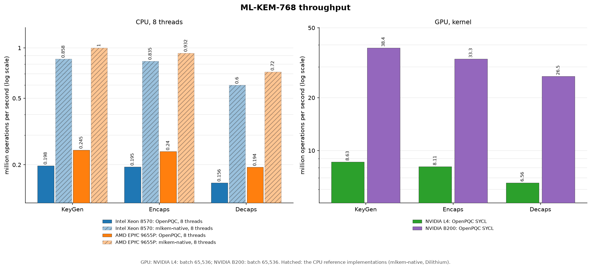
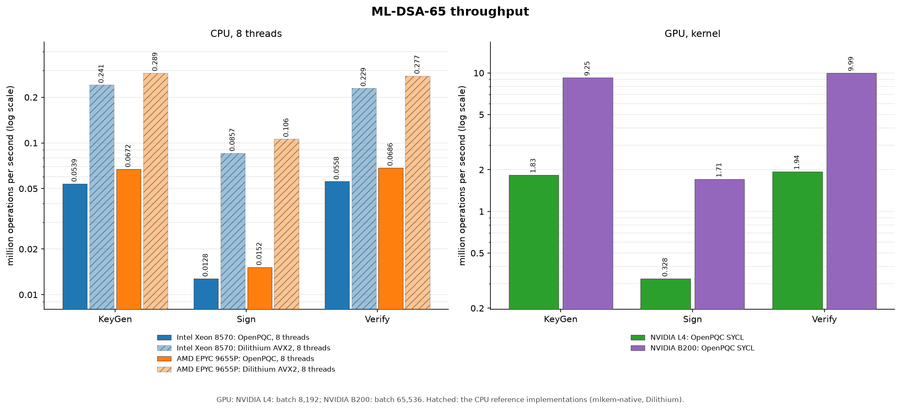
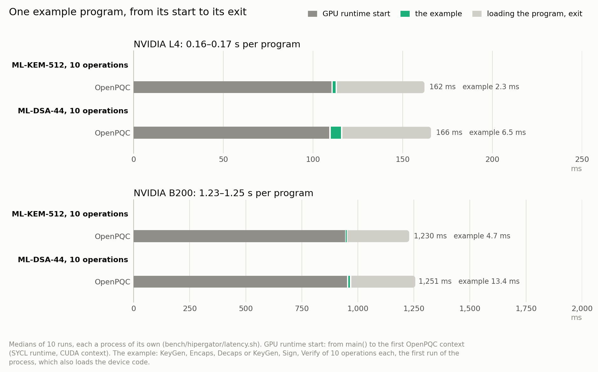
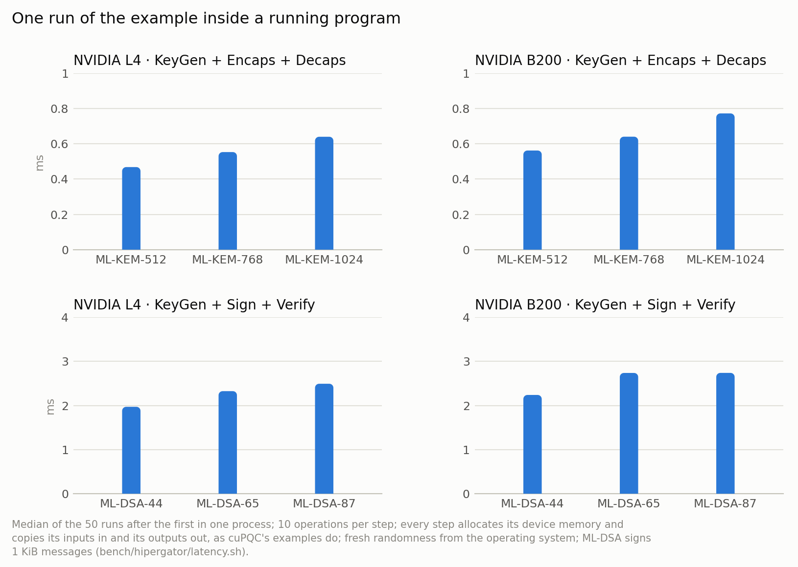

# Benchmarks on HiPerGator (University of Florida)

Scripts that build and run `bench/run_benchmarks.sh` on HiPerGator's node types, with the cuPQC baselines,
and `bench/plot_platforms.py` to put the machines side by side.

| Node type (partition) | CPU | GPU | Job |
|---|---|---|---|
| B200 (`hpg-b200`) | 2 × Intel Xeon Platinum 8570 (Emerald Rapids, 112 cores, AVX-512, AMX) | 8 × NVIDIA B200 (sm_100) | `gpu.sbatch`, `SM=100 NAME=b200`, 56 cores: the CPU and the GPU |
| L4 (`hpg-turin`) | AMD EPYC 9655P (Zen 5, 96 cores, AVX-512) | 3 × NVIDIA L4 (sm_89) | `gpu.sbatch`, `SM=89 NAME=l4 SKIP_CPU=1`, 8 cores; the CPU in `cpu.sbatch` on the whole node |
| RTX PRO 6000 (`hpg-rtx6000`) | 2 × AMD EPYC 9555 (Zen 5, 128 cores) | 8 × RTX PRO 6000 Blackwell (sm_120) | `gpu.sbatch`, `SM=120 NAME=rtxpro6000` |
| CPU nodes (`hpg-default`, `hpg-milan`) | AMD EPYC 7702 (Zen 2) / 75F3 (Zen 3), AVX2 | — | `cpu.sbatch` |

GPU partitions refuse jobs without `--gpus` (`hpg-turin` accepts CPU jobs). The investment QoS limits the cores of
the whole group (96 for qi855292), and GPU jobs need it: when the group's other jobs hold most of them, give the GPU
job few cores (`SKIP_CPU=1`, or `BENCH_THREAD_LIST=1,4,8` with `-c 8`). The burst QoS (`<group>-b`) has more cores but
no GPUs: use it for the builds and the CPU jobs. Whole Turin nodes are rarely idle; 32 cores of one
(`-c 32 BENCH_THREAD_LIST=1,4,8,16,32`) start at once and cover the thread counts of the other machines.

## Why a container

HiPerGator runs RHEL 9 (glibc 2.34), and its oneAPI module (2025.1) has no CUDA adapter: `sycl-ls` finds no NVIDIA
GPU. The DPC++ nightlies of [intel/llvm](https://github.com/intel/llvm/releases) have one, but they need glibc ≥ 2.35.
So the SYCL code is compiled and run with DPC++ `nightly-2026-10-11` (the version of the measurements in
`src/ML/DSA/README.md`) inside the image `nvidia/cuda:12.9.1-devel-ubuntu24.04` (Apptainer, `--nv`), ahead of time
for one GPU architecture per tree. The CPU benchmarks and the cuPQC baselines are built natively with GCC 14 and
CUDA 12.9 (modules), and `run.sh` runs each kind where it was built, appending to the same results directory.

## Steps

```sh
export OPQC_TOOLS=/path/with/10GB/free            # toolchains and build trees
# 1. toolchains (DPC++, the image, a portable CMake): in a job with 32 GB or more, since building
#    the image's squashfs needs the memory
srun -A <group> --qos=<group>-b -c 8 --mem=32G -t 1:00:00 bench/hipergator/setup_toolchains.sh
# 2. optional: cuPQC. Download and unpack the SDK yourself; doing so accepts NVIDIA's licence.
export CUPQC_DIR=/path/to/cupqc-sdk-0.6.0-x86_64
# 3. the trees for the L4 and the B200 (a CPU job; no GPU needed)
sbatch -A <group> --qos=<group>-b -c 16 --mem=64G -t 2:00:00 --wrap "bench/hipergator/build.sh 89 100"
# 4. the runs: results of OpenPQC in OUT_DIR, cuPQC's in $OPQC_TOOLS/cupqc-results/<name>
SM=100 NAME=b200 sbatch -A <group> --qos=<group> -p hpg-b200 --gpus=1 -c 56 bench/hipergator/gpu.sbatch bench/results/b200
SM=89 NAME=l4 SKIP_CPU=1 sbatch -A <group> --qos=<group> -p hpg-turin --gpus=1 -c 8 bench/hipergator/gpu.sbatch bench/results/l4
sbatch -A <group> --qos=<group>-b -p hpg-turin -c 96 --exclusive bench/hipergator/cpu.sbatch bench/results/epyc9655p
# 5. the figures and tables
python3 bench/plot_platforms.py --scheme mlkem --platform "Xeon 8570 + B200=bench/results/b200" \
    --platform "EPYC 9655P=bench/results/epyc9655p" --platform "L4=bench/results/l4" --out mlkem.png
# 6. the latency of one example program (ML-KEM KeyGen, Encaps, Decaps; ML-DSA KeyGen, Sign, Verify), OpenPQC
#    and cuPQC, and cuPQC's own examples as whole programs if CUPQC_EXAMPLES holds them (see cuPQC below)
CUPQC_EXAMPLES=/path/to/examples-sm89 sbatch -A <group> --qos=<group> -p hpg-turin --gpus=1 -c 2 --mem=8G \
    -t 0:30:00 --wrap "bench/hipergator/latency.sh bench/results/l4-latency 89 l4"
python3 bench/compare_latency.py bench/results/l4-latency $OPQC_TOOLS/cupqc-results/l4-latency
```

Every GPU run starts with `test_mlkem_sycl` and `test_mldsa_sycl` on that GPU: the benchmarks run only if every
output is byte-identical to the CPU library's.

## cuPQC

- Its results are confidential under NVIDIA's evaluation licence. `run.sh` writes them to `$CUPQC_OUT` (default
  `$OPQC_TOOLS/cupqc-results/<name>`), never to the results directory; `plot_platforms.py --cupqc LABEL=CSV` marks every
  figure and table that contains them. Keep those out of the repository and of publications unless NVIDIA approved.
- cuPQC 0.6.0 ships its device code as LTO IR for sm_80, 86, 89 and 90 (`cuobjdump lib/libcupqc-pk.a`); its
  documentation lists those architectures only.
- `bench_cupqc_mlkem` and `bench_cupqc_mldsa` first compare cuPQC with the OpenPQC CPU library byte for byte (keys,
  ciphertexts, signatures, shared secrets, verification decisions, in both directions) and say which FIPS 204 function
  cuPQC's Sign computes, with and without a context string; then they measure every block dimension.
- nvcc refuses `-dlto` together with the `-gencode` options that `CMAKE_CUDA_ARCHITECTURES=<number>` produces, so
  `build.sh` names the GPU with `-arch=sm_XX` (as `native` does on a machine with that GPU).
- `bench_latency_cupqc` repeats the steps of cuPQC's examples (`examples/public_key` of
  [github.com/NVIDIA/cuPQC](https://github.com/NVIDIA/cuPQC)) with timers. The examples themselves build with
  `nvcc -dlto -arch=sm_XX -std=c++17 -O3 -I$CUPQC_DIR/include -I$CUPQC_DIR/include/cupqc example_ml_kem.cu
  -L$CUPQC_DIR/lib -lcupqc-pk` (their Makefile's `-arch=native` needs the GPU on the build machine). Use the
  repository's copies: in the one in SDK 0.6.0 (`example/public_key`), `ml_kem_keygen` takes the key vectors by value,
  so Encaps and Decaps run on all-zero keys.

## Notes

- The CPU benchmarks run on as many threads as the job may use (`nproc`, the Slurm allocation), not on all cores of
  the node; `BENCH_THREADS` overrides it.
- An inherited `PYTHONHOME` (for example of `/apps/python`) breaks the system Python that CMake finds; the scripts
  unset it.
- Large GPUs need large batches: on the B200, ML-DSA still gains from 8,192 to 65,536 operations per call
  (`MLDSA_BATCHES=8192,16384,32768,65536`), ML-KEM from 32,768 to 65,536.

## Results (2026-10-21)

OpenPQC 0.3.0; SYCL: DPC++ nightly-2026-10-11 in the container, ahead of time for sm_89 / sm_100, NVIDIA driver
580.178.04; CPU: GCC 14.2 `-O3`, the references with their AVX2 code. Before the measurements, `test_mlkem_sycl` and
`test_mldsa_sycl` passed on the L4 and the B200 (every output byte-identical to the CPU library). The CPU jobs had 8
cores of a shared B200 node (Xeon) and 32 cores of a shared L4 node (EPYC); the tables compare them at 1 and 8
threads. GPU: the largest batch measured, kernel-only (inputs and outputs in device memory) and end to end (with the
copies from and to page-locked host memory).



ML-KEM-768, operations per second (KeyGen / Encaps / Decaps):

| | 1 thread | 8 threads | GPU kernel | GPU end to end |
|---|---|---|---|---|
| Intel Xeon Platinum 8570: OpenPQC | 24.7k / 24.6k / 19.5k | 198k / 195k / 156k | | |
| Intel Xeon Platinum 8570: mlkem-native (AVX2) | 110k / 100k / 80.5k | 858k / 835k / 600k | | |
| AMD EPYC 9655P: OpenPQC | 31.6k / 30.4k / 24.8k | 245k / 240k / 194k | | |
| AMD EPYC 9655P: mlkem-native (AVX2) | 123k / 118k / 90.9k | 1.00M / 932k / 720k | | |
| NVIDIA L4: OpenPQC SYCL, batch 65,536 | | | 8.63M / 8.11M / 6.56M | 4.11M / 5.35M / 4.01M |
| NVIDIA B200: OpenPQC SYCL, batch 65,536 | | | 38.4M / 33.3M / 26.5M | 10.9M / 13.8M / 9.85M |



ML-DSA-65, operations per second (KeyGen / Sign / Verify; Sign of 64-byte messages, no context string):

| | 1 thread | 8 threads | GPU kernel | GPU end to end |
|---|---|---|---|---|
| Intel Xeon Platinum 8570: OpenPQC | 7.06k / 1.63k / 6.80k | 53.9k / 12.8k / 55.8k | | |
| Intel Xeon Platinum 8570: Dilithium AVX2 | 28.7k / 10.7k / 29.5k | 241k / 85.7k / 229k | | |
| AMD EPYC 9655P: OpenPQC | 8.60k / 1.95k / 8.59k | 67.2k / 15.2k / 68.6k | | |
| AMD EPYC 9655P: Dilithium AVX2 | 36.7k / 13.5k / 35.2k | 289k / 106k / 277k | | |
| NVIDIA L4: OpenPQC SYCL, batch 8,192 | | | 1.83M / 328k / 1.94M | 1.38M / 307k / 1.52M |
| NVIDIA B200: OpenPQC SYCL, batch 65,536 | | | 9.25M / 1.71M / 9.99M | 4.59M / 1.39M / 5.10M |

- Per core, the Zen 5 EPYC is 11–28 % faster than the Emerald Rapids Xeon, for both implementations of both
  schemes; the AVX2 references are 3.7–4.5× (ML-KEM) and 4.0–7.0× (ML-DSA, Sign the most) as fast as OpenPQC's
  portable C on either CPU.
- The GPUs need batches: on the B200, OpenPQC reaches half of its peak throughput at roughly 4,000 operations per call
  for ML-KEM-768, and between roughly 1,500 (KeyGen) and 6,500 (Sign) for ML-DSA-65 (`sycl_*.csv`, `mldsa_sycl_*.csv`).

Latency of one example program on the L4 (`latency.sh`; `bench_latency_sycl` in the style of cuPQC's examples: every
step allocates its device buffers, copies its inputs from host memory and its outputs back, with fresh randomness
from the operating system; median of 50 runs after the first):

| | 1 operation per step | 10 operations per step |
|---|---|---|
| ML-KEM-512 / -768 / -1024: KeyGen, Encaps, Decaps | 0.45 / 0.52 / 0.60 ms | 0.47 / 0.55 / 0.64 ms |
| ML-DSA-44 / -65 / -87: KeyGen, Sign, Verify (1 KiB messages) | 0.96 / 1.08 / 1.22 ms | 1.97 / 2.33 / 2.49 ms |

As a whole program (one ML-KEM-512 or ML-DSA-44 example, 10 operations, in a process of its own) it takes 162–166 ms:
110 ms until the SYCL runtime and the CUDA context are up, 2.3 ms (ML-KEM) or 6.5 ms (ML-DSA) for the example — its
first run also loads the device code —, and 49 ms to load the program and to exit. More operations per step cost
little until the GPU fills up, except Sign: 10 signatures take 3.2–3.6× as long as one (`latency.csv` has every step).
On the B200 the same program takes 1.23–1.25 s: 0.95 s until the runtime is up, 0.28–0.29 s to load and exit, and
4.7 ms (ML-KEM) or 13.4 ms (ML-DSA) for the example. Its steps take 0.53–0.77 ms (ML-KEM) and 1.1–2.7 ms (ML-DSA), a
little longer than on the L4: a larger GPU does not shorten the latency of a few operations.





`bench/plot_latency.py --platform LABEL=DIR ... --out PREFIX` draws these from the directories of `latency.sh` (with
`--cupqc LABEL=DIR` also cuPQC's, and `PREFIX_steps.png`, the steps of ML-KEM-768 and ML-DSA-65).
